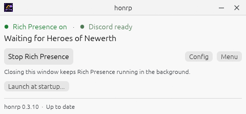
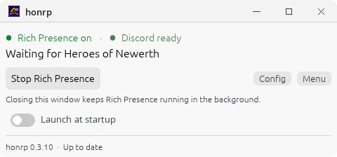
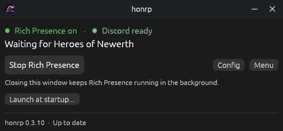
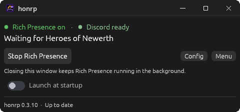
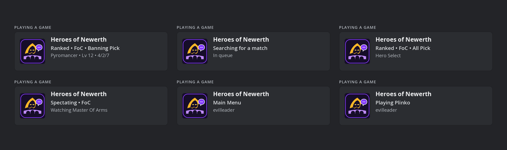

<p align="center">
  
</p>

<h1 align="center">honrp</h1>

<p align="center">
  <strong>Discord Rich Presence for Heroes of Newerth: Reborn</strong><br>
  Linux and Windows · automatic match status · no game files touched · no admin
</p>

<p align="center">
  <a href="https://github.com/NasirA1991/honrp/releases/latest"></a>
  <a href="https://github.com/NasirA1991/honrp/actions/workflows/ci.yml"></a>
  <a href="https://aur.archlinux.org/packages/honrp-bin"></a>
  <a href="LICENSE"></a>
  
</p>

## Install

### Windows 10 / 11

1. **[Download the latest installer](https://github.com/NasirA1991/honrp/releases/latest)** — `honrp-setup-*.exe`.
2. Run it. It installs per-user, with no admin prompt, and adds **honrp** to the Start Menu.
3. Open **honrp** and click **Start Rich Presence**.
4. Restart Heroes of Newerth once so the Lua bridge loads.

The installer writes the bridge automatically when honrp starts. If you use the portable zip instead, run `honrp.exe install` once from the extracted folder.

> Windows SmartScreen may warn because the build is unsigned. Click **More info → Run anyway**, or unblock the zip before extracting.

### Linux

**Arch Linux / CachyOS**

```bash
paru -S honrp-bin
honrp install
honrp
```

**Debian / Ubuntu**

Download the `.deb` from the [latest release](https://github.com/NasirA1991/honrp/releases/latest), then:

```bash
sudo apt install ./honrp_*.deb
honrp install
honrp
```

**Fedora**

Download the `.rpm` from the [latest release](https://github.com/NasirA1991/honrp/releases/latest), then:

```bash
sudo dnf install ./honrp-*.rpm
honrp install
honrp
```

**Any distro — install script**

```bash
curl -fsSL https://github.com/NasirA1991/honrp/releases/latest/download/install.sh | bash
"$HOME/.local/bin/honrp"
```

`honrp install` writes the Lua bridge, installs the background service and adds the app-menu entry and icons. It runs as your user; nothing in the game install directory is modified. If it cannot find your game folder, start Heroes of Newerth once and run it again.

The Linux window needs Wayland or X11 and a Vulkan-capable driver. The packages pull in the rest; for the standalone tarball, install your distro's `libxkbcommon`, Wayland/X11 and Vulkan loader packages.

### After installing

Open **honrp**, click **Start Rich Presence**, then launch Heroes of Newerth. If you were already in-game, restart it once. No Discord application setup is needed — the app id is built in.

## What it looks like

| | Linux | Windows |
|---|---|---|
| **Light** |  |  |
| **Dark** |  |  |

The control window stays out of the way: current status, one action button, Config and Menu. It follows your system light/dark theme.

## What it shows

<p align="center">
  
</p>

| Where you are | What Discord shows |
|---|---|
| Main menu | Main Menu · account |
| Searching | Searching for a match · In queue |
| Hero select | Ranked · FoC · All Pick · Hero Select |
| In a match | Ranked · FoC · Banning Pick · hero, level and KDA |
| Spectating | Spectating · FoC · the hero you are watching |
| Plinko | Playing Plinko · account |

The image is a Discord-style preview of the six card payloads, not a screenshot; Discord's exact spacing, font and app artwork vary by client and theme. While in a match, hover the app window to see hero, level and KDA; the card itself stays compact.

## Why honrp

- **It just works.** It finds HoN through Steam/Proton, Lutris, Heroic, Faugus, Bottles or plain Wine — no library paths to configure.
- **Nothing invasive.** It reads the game's own `console.log`, never game memory, and never changes game files. The Lua bridge is one managed block in `startup.lua`.
- **A proper desktop app.** A compact native window for status, settings and updates — no browser, no tray icon, no console left behind.
- **Private by default.** It talks only to Discord's local socket; no telemetry, no analytics, no account login.

## Help

These cover almost every report. Click **Help** in the app to come back here.

| Problem | Easy fix |
|---|---|
| Discord says **Playing honrp** while Rich Presence is off | That is Discord's process detection, not honrp. Use the installed app rather than a checkout under a `Games/` folder, then remove or disable **honrp** in Discord **Settings → Registered Games**. |
| Generic icon on Wayland / taskbar | Run `honrp install` once with the installed binary. It writes the desktop entry and hicolor icons; restart honrp, or log out and back in if the old icon is cached. |
| **Discord not running** / **Can't connect to Discord** | Start Discord. Flatpak Discord uses a different socket: set it in **Config → Discord IPC socket** (`$XDG_RUNTIME_DIR/app/com.discordapp.Discord/discord-ipc-0`). `honrp doctor` lists every socket it tries. |
| No hero, level or KDA | Restart Heroes of Newerth after installing or updating. `honrp doctor` shows whether the Lua bridge is loaded. |
| Two cards: honrp **and** Juvio | Disable `juvio.exe` once in Discord **Settings → Game Activity → Registered Games**. honrp cannot change that list. |
| Windows SmartScreen warning | The build is unsigned: choose **More info → Run anyway**, or right-click the zip → **Properties → Unblock** before extracting. |
| `honrp install` cannot find HoN | Start HoN once, or pick the folder in **Config → Game folder**, or pass `--user-dir`. |
| No window on Wayland / VM | The window needs a Vulkan-capable driver. `honrp run` starts the same daemon headlessly. |
| Linux service is not running | `systemctl --user status honrp`, then `journalctl --user -u honrp`; rerun `honrp install` if needed. |
| Updating | AUR: `paru -Syu` or `yay -Syu`. Standalone tarball: `honrp update`. |

### Still stuck?

<details>
<summary><b>Windows</b> — more detail</summary>

- **Portable zip:** run `honrp.exe install` once from the extracted folder, then open `honrp.exe`. The installer does the same setup automatically.
- **Uninstall:** Windows Settings → Apps → honrp. The uninstaller stops the daemon and removes the managed bridge block from `startup.lua`; content you added outside that block is kept.
- **Logs and diagnostics:** `honrp.exe doctor`, and `%APPDATA%\honrp\daemon.log`.
- **Updater requirements:** `curl` and `tar`; both ship with Windows 10 and 11.

</details>

<details>
<summary><b>Linux</b> — more detail</summary>

- **Prefix/game folder:** run `honrp doctor` after starting HoN once. Override with `honrp install --prefix <pfx>` or `--user-dir <dir>`, or set `user_dir` in **Config**.
- **Bridge updates:** the Lua bridge is embedded in the binary and rewritten when the daemon starts; restart HoN afterwards. `honrp doctor` prints the loaded build.
- **Service:** `systemctl --user status honrp` and `journalctl --user -u honrp`; `honrp install` recreates the unit.
- **Logs:** `~/.config/honrp/daemon.log`.
- **AUR vs tarball:** use `paru -Syu` for the AUR package; `honrp update` is for the standalone tarball.

</details>

## Commands

| Command | What it does |
|---|---|
| `honrp` | Opens the control window |
| `honrp install` | Writes the bridge, installs the service, desktop entry and icons |
| `honrp run` | Runs the background daemon in the foreground |
| `honrp status [--json]` | Shows what the daemon currently sees |
| `honrp doctor` | Checks prefix, bridge, Discord and service state |
| `honrp stop` | Stops the background daemon (the window stays open) |
| `honrp update [--check]` | Updates the standalone binary from GitHub |
| `honrp uninstall` | Removes the bridge, service, desktop entry and icons; keeps settings |
| `honrp uninstall --purge` | Also removes `~/.config/honrp` (or `%APPDATA%\honrp`) |

## Development

```bash
cargo test
lua5.1 tests/test_lua_mod.lua lua/honrp_mod.lua
lua5.1 tests/test_lua_reload.lua lua/honrp_mod.lua
```

Build a headless binary without the GUI dependencies with `cargo build --release --no-default-features`.

- [Branch changes and implementation notes](docs/BRANCH-CHANGES.md)
- [Linux porting notes](docs/PORTING-LINUX.md)
- [How the bridge works](docs/REVERSE_ENGINEERING.md)

## Artwork

The honrp mark — a gold hood, a three-arch bridge and a chat bubble — is original artwork, not a Heroes of Newerth or Discord logo.

<p align="left">
  
</p>

- App icon source: [`assets/icon.svg`](assets/icon.svg), exports in [`assets/icon.png`](assets/icon.png), [`assets/icon.ico`](assets/icon.ico) and [`assets/icons/hicolor/`](assets/icons/hicolor)
- Banner, avatar and social preview: [`assets/branding/`](assets/branding)
- Colours and usage rules: [`docs/BRANDING.md`](docs/BRANDING.md)

## Privacy & license

No telemetry and no game memory access. Read [`PRIVACY.md`](PRIVACY.md) for the details. MIT licensed — see [`LICENSE`](LICENSE).
