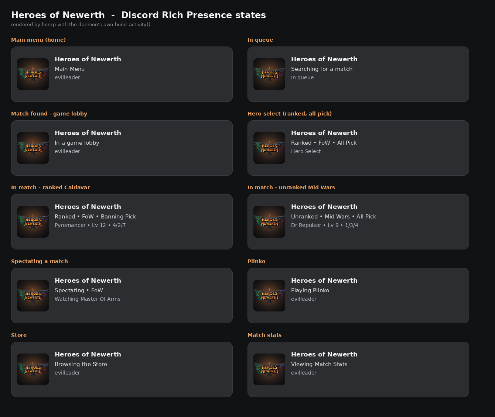

# honrp — Heroes of Newerth Discord Rich Presence for Linux

Discord Rich Presence for the current **Juvio / Heroes of Newerth** client
(0.13.x) running through Steam Play / Proton on Linux.

```
┌──────────────────────────────────────────────┐
│  Heroes of Newerth Reborn                    │
│  Ranked • FoW • Banning Pick                 │
│  Pyromancer • Lv 12 • 4/2/7                  │
└──────────────────────────────────────────────┘
```

Two pieces:

| piece | what it does |
|---|---|
| `honrp_mod.lua` | ~200 lines of Lua installed as `<Documents>/Juvio/Heroes of Newerth/startup.lua`. Runs in the game's own UI Lua VM and prints one `[HONRP] {json}` line per state change plus a 10 s heartbeat into `console.log`. |
| `honrp.py` | Linux daemon. Finds `juvio.exe` in `/proc`, tails `console.log`, drives Discord's native `discord-ipc-N` unix socket. |

Nothing in the game install directory is modified. The mod lives next to the
game's own settings files and is read by the engine at launch.



> **Project status:** reference implementation in Python. The static Rust port
> and release plan are in [docs/PLAN.md](docs/PLAN.md); the Lua bridge and the
> presence format are already final and shared by both.

## Rust binary (in progress)

`rust/honrp` is the static-binary port of the daemon — same Lua bridge, same
presence format:

```bash
cargo build --release --manifest-path rust/honrp/Cargo.toml
./rust/honrp/target/release/honrp status --json
./rust/honrp/target/release/honrp run          # after configuring client_id
```

Current release binary: ~**814 KB**, ~**6 MiB RSS** idle, 9 unit tests plus an
end-to-end mock-Discord run (publish → clear on game exit). See
[rust/README.md](rust/README.md) for the parity checklist.

## Privacy & transparency

honrp is local-only and deliberately boring:

- reads `console.log`, the client's `logs/game_*.log`, and `/proc` for the
  running `juvio.exe` — nothing else;
- writes the managed `startup.lua` block, `~/.config/honrp/config.json` and a
  systemd **user** unit (no root);
- talks **only** to Discord's local unix socket — no HTTP, no telemetry;
- never opens game memory, never reads input, never modifies the game install.

The full list, including measured CPU/RAM and verification commands
(`strace`, `ss`, `honrp doctor`), is in [PRIVACY.md](PRIVACY.md).

---

## Why this works (reverse engineering notes)

The short version of what the investigation found.

### Target layout

`juvio.exe` is a CEF-based launcher *and* the game entry point. It loads:

| file | size | role |
|---|---|---|
| `bin/k2.dll` | 39 MB | K2 engine — 91,925 `.pdata` functions, 4,440 exports with full C++ symbols |
| `bin/client.dll` | 7.7 MB | game client logic + game UICmds |
| `bin/origami.dll` | 91 MB | UI/WebKit layer (`[Origami …]` log channel) |
| `heroes of newerth/resources0.jz` | 9.5 GB | **plain ZIP**, 55,304 entries — including *source* Lua UI (`ui/scripts/fe3/*.lua`, `ui/scripts/game/*.lua`), `.interface` XML and string tables |

The UI Lua is not compiled: `ui/scripts/fe3/main.lua` and friends are shipped as
readable source, and `ui/scripts/shared/global_main.lua` even starts with
`-- ATTENTION MODDERS: DO NOT MODIFY THIS SCRIPT`.

### The hook: `startup.lua`

`k2.dll` exports `?Init@CHost@@QEAAXAEBV…` at `0x1805f7b00`. Near the end of
`CHost::Init` the engine does (disassembly at `0x1805f938d`):

```
mov  r8d, 0x0d                        ; length of "#/startup.lua"
lea  rdx, [rip+…]                     ; L"#/startup.lua"  (RVA 0x181fa5b08)
lea  rcx, [rsp+0x40]
call std::wstring::assign
mov  rcx, g_pFileManager
call CFileManager::Exists             ; "#/" = user documents dir
test al, al / testb $0x20, [host+0x3f0]
call g_pLuaManager->ExecuteFile       ; 0x1809c4820  CLuaManager::ExecuteFile
```

The `0x20` bit in the host flags is "config locked" (`-noconfig`); the live
console log does **not** contain *"Startup config is locked; using defaults for
this launch"*, and `Executing "#/startup.cfg"` is present, so user scripts are
enabled in the normal Steam path. `/server.lua` and `/client.lua` are executed
through the same `ExecuteFile` call just after it.

`#/` maps to `…/Documents/Juvio/Heroes of Newerth/`, the same directory the game
already writes `startup.cfg`, `game_settings_local.cfg` and `console.log` to.
`startup.lua` runs in the shared global Lua table, *before* the UI loads, which
is why the mod only seeds `Main` and starts its tick when `main.interface`
calls `Main:Init()`.

### Reading state from inside the UI

`CUICmd` is the engine's expression/command registry (`pUICmdRegistry`,
`CUICmdRegistry::GetInstance`). Every entry is a tiny static registration
function that constructs `? ?0CUICmd@@@…` with a name and a handler; they can
be enumerated statically. The useful ones:

| UICmd | handler | meaning |
|---|---|---|
| `IsInGame()` | `client!0x1802acdb0` | returns `"1"` / `"0"` |
| `IsInQueue()` | `k2!0x1801464a0` | matchmaking queue |
| `GetCurrentGamePhase()` | `client!0x1802acc00` | `CGameInfo+0xb4` (`EGameServerPhase`) as int |
| `GetCurrentLobbyPhase()` | `client!0x1802acd20` | `ELobbyPhase` |
| `GetCurrentClientPhase()` | `client!0x1802acc90` | chat/connection phase (`Enum.ClientPhase.CONNECTED = 5`) |
| `GetLocalHeroName()` | `client!0x1802ad400` | local hero |
| `GetLocalTeam()`, `GetNumClients()`, `GetAccountName()`, `GetPing()` | | |

`ui/scripts/shared/global_main.lua` wraps these as plain Lua helpers
(`IsInGame()`, `IsInQueue()`, `GetCurrentClientPhase()`, …) via
`interface:UICmd("…")`, and the phase enums live in
`ui/scripts/shared/enums.lua`.

Two scheduling primitives are used by the shipped UI and are available to a
mod:

* `widget:Sleep(ms, fn)` — one-shot timer on any widget, used by
  `ui/scripts/shared/widget_anims.lua` (`widget:Sleep(interval, Tick)`).
* `widget:SetCallback('onframe', fn)` — per-frame callback, used by
  `ui/test_suite/test_suite.lua`.

The mod uses both: state changes emit immediately, the timers provide a 10 s heartbeat.

### The log bridge

`console.log` is UTF-16LE and every Lua `println` / `print` is captured in it
(`con_writeLog`, `~/console.log`). That is verified in the shipped client: the
`^cROLEPICK …` debug lines in the current log come from
`ui/scripts/shared/role_pick_shared.lua:println`.

So the data path is just:

```
game Lua VM  --print-->  console.log  --tail-->  honrp.py  --unix socket-->  Discord
```

No memory reading, no ptrace, no DLL injection, no archive repacking, no
network protocol work.

### Extra data: map and mode

`~/Documents/Juvio/Heroes of Newerth/logs/game_NNNNN.log` is the per-match log
(UTF-16LE), created when a match starts:

```
INFO_DATE date:"2026/10/30" time:"00:13:57"
INFO_MATCH name:"Field Test" id:"4294967295"
INFO_MAP name:"fieldtest" version:"0.0.0"
INFO_SETTINGS mode:"Mode_Normal" options:"Option_None"
```

`honrp.py` parses it for the map/mode and uses `INFO_DATE` as the presence
timestamp, so the elapsed clock matches the actual match.

---

## Install

```bash
# 1. install the Lua bridge into the running Proton prefix
python3 honrp.py install

# 2. restart Heroes of Newerth (the engine reads startup.lua at launch)

# 3. check that the bridge is alive (a JSON line per state change / 10 s)
grep -a HONRP \
  "$HOME/.steam/steam/steamapps/compatdata/2618010418/pfx/drive_c/users/steamuser/Documents/Juvio/Heroes of Newerth/console.log" | tail

# 4. Discord application id (see below), then start the daemon
python3 honrp.py run
```

`honrp.py install` auto-detects the game prefix by reading
`STEAM_COMPAT_DATA_PATH`/`WINEPREFIX` from the running `juvio.exe`. Use
`--user-dir '…/Heroes of Newerth'` to override.

### Discord developer portal: what to fill in

The app is only an identity for the activity, so almost every section can stay
empty. Nothing here needs verification, a bot, or a public listing.

| Portal section | What to do |
|---|---|
| **General Information → Name** | `Heroes of Newerth` — this is the literal "Playing …" title |
| **General Information → Description / Tags** | optional; only used by the App Directory, not by presence. Leave blank or write anything |
| **General Information → App Icon** | optional; shows as the app badge on the activity card. `assets/hon.png` works |
| **Rich Presence → Art Assets** | the only required artwork: upload `assets/hon.png`, asset name `hon` |
| **Installation** | Install Link → **None** (this is not an installable app) |
| **Bot** | do **not** add one. A bot user/token is unnecessary for Rich Presence |
| **OAuth2 / Webhooks / Emojis** | leave untouched; they are for bots and Activities |
| **Activities / Embedded App / Monetization** | leave untouched |

Nothing is verified or reviewed: an unverified private app can send Rich
Presence indefinitely.

### Discord application id

Rich Presence needs an application id (this is how Discord knows the name and
artwork to show):

1. <https://discord.com/developers/applications> → **New Application**
2. copy the **Application ID**
3. optionally add a **Rich Presence asset** named `hon` (512×512) for the logo
   — `assets/hon.png` in this repo is generated from the official
   `ui/fe3/elements/reborn_logo.tga` client asset (the HoN Reborn wordmark);
   upload it under **Rich Presence → Art Assets → Add Image(s)** and name the
   asset `hon`. `assets/hon-transparent.png` is the same logo without the dark
   backdrop, and `assets/hon@1024.jpg` is a 1024×1024 variant. Until the asset
   exists Discord silently drops the `large_image` field (the presence still
   works, just without the picture).
4. put the id in `~/.config/honrp/config.json`:

```json
{
  "client_id": "123456789012345678",
  "large_image": "hon",
  "large_text": "Heroes of Newerth"
}
```

or export `HONRP_CLIENT_ID=123…`.

The **application name** becomes the activity title in Discord ("Playing …"),
so name the app `Heroes of Newerth` (or rename it later under General
Information; the id does not change).

Then `python3 honrp.py run` (add `-v` for verbose logs).

### Autostart (optional)

```bash
mkdir -p ~/.config/systemd/user
cat > ~/.config/systemd/user/honrp.service <<'EOF'
[Unit]
Description=Heroes of Newerth Discord Rich Presence
After=graphical-session.target

[Service]
ExecStart=%h/path/to/honrp/honrp.py run
Restart=always
RestartSec=5

[Install]
WantedBy=default.target
EOF
systemctl --user daemon-reload
systemctl --user enable --now honrp
```

---

## Usage

```
honrp.py run [--client-id ID] [--ipc-socket PATH] [--dry-run] [-v]
honrp.py status             # dump detected state + the activity it would send
honrp.py install            # write startup.lua into the HoN user dir
honrp.py uninstall          # remove the managed block again
honrp.py mock-discord PATH  # fake Discord endpoint used by the tests
```

`--dry-run` prints the presence updates as JSON without touching Discord —
handy when Discord is not running or the app id is not configured yet.

```bash
python3 honrp.py status | jq .state
```

`status` also reports `mod_installed` and `restart_needed` — if the Lua bridge
was written after the current game process started, `restart_needed` is `true`
and the daemon prints a reminder on start.

### Is it running?

The service is a normal systemd user unit:

```bash
systemctl --user status honrp     # active (running), logs in the journal
python3 honrp.py status           # what it sees right now (game, queue, activity)
journalctl --user -u honrp -f     # live
```

There is no tray icon by default — a resident tray app would use more memory
than the daemon itself, and hoisting one is exactly the kind of hidden overhead
this project avoids. An opt-in StatusNotifierItem indicator is on the roadmap;
until then `status`/`doctor` are the indicator.

## Repository layout

```
honrp.py            daemon (reference implementation)
honrp_mod.lua       Lua bridge, installed as startup.lua
assets/             Rich Presence art + generator (see assets/README.md)
tests/              Python unit/integration tests + mocked K2 Lua harness
docs/PLAN.md        Rust port, packaging and release plan
PRIVACY.md          exactly what is read/written, resource use, verification
```

## Tests

```bash
./tests/run_all.sh          # everything
python3 tests/test_honrp.py # daemon: log tailing, parsing, activity, Discord IPC
lua5.1 tests/test_lua_mod.lua honrp_mod.lua   # mod: mocked K2 Lua environment
```

The Python suite covers UTF-16LE log tailing, `[HONRP]` parsing, match-log
parsing, fallback world-load detection, activity construction, and a full
Discord IPC handshake + `SET_ACTIVITY` round-trip against an in-process mock
endpoint.  The Lua suite runs the real `honrp_mod.lua` against mocked
`println`/`GetTime`/`UIManager`/widget objects, both with `UIManager` present
and in the `Main:GetWidget` fallback path, and checks the emitted JSON.

### What was verified vs. not

Verified on this machine:

* live discovery of the running `juvio.exe` (pid 1211678), its Proton prefix and
  the `Documents/Juvio/Heroes of Newerth` directory;
* `console.log` UTF-16LE tailing against the live log;
* the full Discord IPC handshake and `SET_ACTIVITY` frames against a mock
  endpoint;
* the Lua mod under a mocked K2 Lua environment (`luac5.1 -p` clean);
* the static hook evidence (`#/startup.lua` → `CLuaManager::ExecuteFile`) and
  that the `-noconfig` guard bit is *not* set in the live run.

Not yet verified: the in-game UICmd return values. The game was already
running while this was built, and `startup.lua` is only read at engine start.
After the next restart, `honrp.py status` should show `"source": "mod"` with
`in_game`/`in_queue`/`hero`/`lobby_phase` populated; if it stays on
`"fallback"`, check the `[HONRP]` lines in `console.log` (the boot line
contains the hook state).

---

## How the presence maps

| detected | details | state | timestamp |
|---|---|---|---|
| in match | `Ranked • FoW • Banning Pick` | `Pyromancer • Lv 12 • 4/2/7` | none (optional) |
| hero select / pre-game (phase 2) | `Ranked • FoW • All Pick` | `Hero Select` | none |
| waiting for players (phase 1) | `Forests of Caldavar • All Pick` | `Waiting for players` | none |
| post-match (phase 4) | `Forests of Caldavar • All Pick` | `Post-Match` | none |
| spectating | `Spectating • Forests of Caldavar` | `Watching Master Of Arms` | match start |
| in queue | `Searching for a match` | `In queue` | session start |
| game lobby | `In a game lobby` | account name | session start |
| main menu | `Main Menu` | account name | session start |
| Plinko | `Playing Plinko` | account name | session start |
| Store / Shop | `Browsing the Store` | account name | session start |
| Ladder / Profile / Match stats / MOTD / Learn | `Viewing …` | account name | session start |
| game closed | *(activity cleared)* | | |

`python3 demo_states.py` renders all of these with the daemon's own
`build_activity()` (text table + `demo_states.png` gallery).

All labels are configurable — `short_maps` ("caldavar"/"caldavarphoenix" →
`FoW`, `midwars` → `Mid Wars`, `fieldtest` → `Field Test`), `show_timer` (off by
default; the hero level is the match-stage signal), `show_kda` (on by default;
turn it off for `hero • Lv N` only).

### What is detected, and where it comes from

| signal | source | confidence |
|---|---|---|
| in match | UICmd `IsInGame()` | exact |
| in queue | `Matchmaking.CurrentState == 3` and the `MatchmakingJoinQueue` / `MatchmakingLeaveQueue` triggers | exact (k2's `IsInQueue()` UICmd is a stub that always returns `"false"` — see below) |
| hero | UICmd `GetLocalHeroName()` | exact |
| hero level | HUD trigger `ActiveLevel(level, skillPoints, showLevelup)` | exact |
| KDA | HUD trigger `PlayerScore(kills, deaths, assists, …)` | exact |
| game clock | HUD trigger `MatchClock(seconds, valid)` | exact |
| pre-game / hero select | `GetCurrentGamePhase()` (`EGameServerPhase`: 0 IDLE, 1 WAITINGFORPLAYERS, 2 PREGAME, 3 INGAME, 4 POSTGAME, 5 FINISHED — documented in `game_shop_hd.lua`). `IsInGame()` is **false in pre-game**, so phase 2 is what identifies the hero-pick screen | exact |
| map | match log `INFO_MAP`, else lobby `worldFancyName` | exact when the match log is written |
| ranked / unranked | `Lobby.lobbyGameInfo.arrangedMatchType` (`EArrangedMatchType`: 2/3 ranked, 4/5 unranked) | exact in matchmade games; empty for practice/custom and when reconnecting with no lobby data |
| rules mode (All Pick, Banning Pick, …) | `Lobby.lobbyGameInfo.gameModeName` / match log `INFO_SETTINGS` | exact |
| game timer | match start from `INFO_DATE`, else first in-game tick | ±1 s |
| spectator | `GetLocalClientNumber()` vs `GetViewClientNumber()`, plus `GetViewHeroName()` | good; verify on a real spectate session |
| menu panel (Plinko, Store, Ladder, …) | visibility of `fs_panel{body}` widgets from `main.interface` | exact |

`IsInQueue()` is a stub: k2's handler at `0x1802e07a0` just returns the constant
string `"false"` (5 chars). The real queue state lives in
`Matchmaking.CurrentState` (`Enum.MatchmakingState`: 0 Offline, 1 NotInGroup,
2 InGroup, 3 InQueue), which the front-end sets from the
`MatchmakingJoinQueue` / `MatchmakingLeaveQueue` triggers. The mod reads both
and also watches those triggers directly, so queue state works.

Not exposed: selected queue modes while searching (kept in a `local` table
inside `matchmaking.lua`), replay-vs-spectate distinction. KDA and level are
read from the HUD's own triggers (`mid_bar.lua`, `bot_center.lua`), not from
memory.

### Resource usage (measured on this machine)

| component | cost |
|---|---|
| `honrp.py` daemon | ~0.3 % of one core, ~15 MiB RSS; one `console.log` read + one `SET_ACTIVITY` per state change |
| Lua bridge | event-driven + 10 s heartbeat: one console line (~40 B/s, ≈144 KB per hour of play, inside the game's existing `console.log`) |
| Discord | `SET_ACTIVITY` only when the activity changes, at most every 5 s |

The bridge emits **on state changes** (queue, lobby, hero pick, panels, kills,
level-ups) and a **10 s heartbeat** otherwise: ~40 B/s / ≈144 KB per hour in a
match instead of 1.4 MB/h at a 1 s cadence.

No memory is read or written, nothing is injected into the render loop; the
bridge rides the UI's existing Lua tick and the game's existing console log.

### Presence lifecycle

The daemon is a resident systemd user service, but it only opens the Discord
IPC connection **while a game is running**. When HoN exits it sends a final
`SET_ACTIVITY` with the *game's* pid and closes the socket, which guarantees
Discord clears the card even if a clear payload is missed. It reconnects on the
next launch. When no game is running the daemon is not connected to Discord at
all (~0.3 % CPU polling for `juvio.exe`).

Fallback when the mod is not installed: `Client loading world <map>` lines in
`console.log` plus the newest `logs/game_*.log` are used for an in-match
approximation; queue state, hero, ranked and panel states only work with the
mod.

---

## Files it touches

* `…/Documents/Juvio/Heroes of Newerth/startup.lua` — created/appended between
  `--- HONRP BEGIN ---` / `--- HONRP END ---` markers; a `.honrp.bak` backup is
  kept if the file already existed. `honrp.py uninstall` removes exactly the
  managed block.
* `~/.config/honrp/config.json` — optional, read-only for the daemon.
* Discord IPC socket `$XDG_RUNTIME_DIR/discord-ipc-0` (or `-1`…`-9`).

## Limitations / caveats

* **Restart required** after installing the Lua bridge.
* The bridge was developed against the 0.13.3.0 client; a client update can
  change or remove the `startup.lua` hook or UICmd names. `honrp.py status`
  shows what is still resolvable (`source: "mod"` vs `"fallback"`).
* `GetCurrentGamePhase()` returns a raw `EGameServerPhase` integer. It is
  logged but not currently rendered as text; the readable phase text comes from
  `GetCurrentLobbyPhase()` + `Enum.LobbyPhase`.
* No in-game KDA/score: the scoreboard data is trigger-driven inside the HUD
  interface, not exposed through the front-end UICmd registry. (Possible future
  work: load a tiny child interface next to `game_hd` and read the same
  triggers.)
* The mod is an observer. It does not read or write game memory, does not send
  input, and does not alter gameplay. It uses the same user-script path the
  engine has always offered for UI mods — keep that in mind if the game's
  integrity rules ever change.
* Discord must be running with its IPC socket available. Flatpak/Discord
  variants are covered by the socket search paths in `discord_sockets()`.

## Other injection points found (for future work)

* `#/override.cfg` and `#/startup.cfg` are executed at boot by
  `CConsole::ExecuteScript`, and the console scripting language has
  `exec` / `call` / `sleep` / `goto` / `if` / `else` / `repeat`.
* Command line: `-mod`, `-editpath`, `-execute`, `-autoexec`, `-noconfig`,
  `-forcetitle` (see the option table in `k2.dll` around `host_startupCfg`).
* `CFileManager` has a real "mod tree" (`ChangeModStack`, `GetModPath`,
  `GetTopModPath`, `fs_disablemods`) — the loading screen comments in
  `ui/fe3/loading.interface` mention it explicitly.
* Console: `UICall <widget> <uicmd>`, `LoadChildInterface`, `ReloadInterface`.
* For a native add-on instead of Lua: `k2.dll` exports `g_pLuaManager`,
  `g_pHost`, `g_pConsole`, and `CLuaManager::ExecuteFile`, so a proxy DLL could
  inject Lua on demand. That is heavier and unnecessary for presence.
